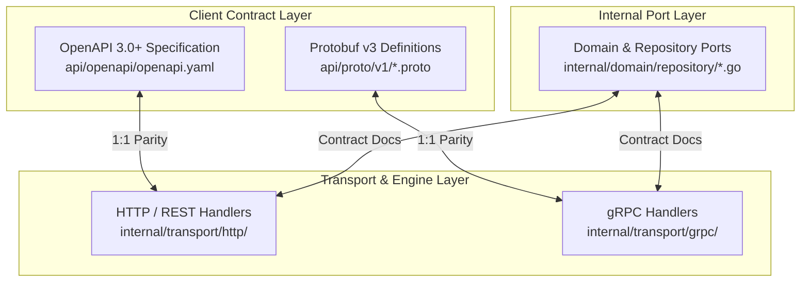
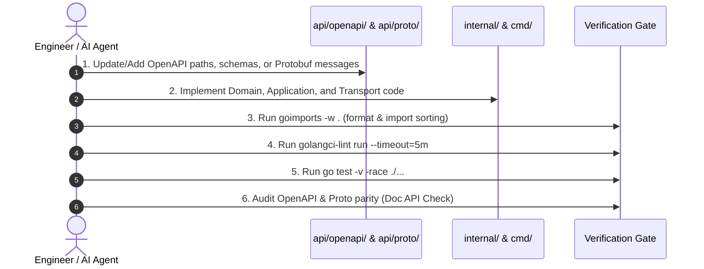

# doc-api.md — API Documentation Standards & OpenAPI Invariants

## 1. Core Principle & Non-Negotiable Invariant

> [!IMPORTANT]
> **Mandatory Doc API Synchronization**:
> The API documentation ("Doc API") **must ALWAYS be updated no matter how little or incremental the created or modified code is.**
> Zero drift between implementation code and external API specifications is strictly enforced. Any pull request or commit that modifies RPC signatures, HTTP handlers, query parameters, payloads, or domain port contracts without synchronous documentation updates will be rejected at the verification gate.

---

## 2. API Documentation Architecture

`rag-chunk-lifecycle-service` exposes high-throughput ingestion and low-latency retrieval interfaces. API specifications are divided into three synchronized layers:



### A. REST / HTTP Layer: OpenAPI 3.0+ Specification
- **Primary Source**: `api/openapi/openapi.yaml`
- **Standard**: OpenAPI Specification (OAS) 3.0.3+
- **Mandate**:
  - Every HTTP endpoint served by `internal/transport/http/` must be explicitly declared in `api/openapi/openapi.yaml`.
  - Must define:
    - `summary` and `description` explaining the operational semantics.
    - Explicit `operationId` corresponding to the Go transport handler.
    - HTTP path parameters, query parameters, and header specifications (e.g., `X-Tenant-ID`, `X-Trace-ID`).
    - `requestBody` schemas with strict validation constraints (field types, token limits, string formats).
    - Complete HTTP response status code mappings:
      - `200 OK` / `201 Created` / `202 Accepted` with schema definition.
      - `400 Bad Request` (payload schema violations, invalid hash formatting).
      - `401 Unauthorized` / `403 Forbidden` (tenant boundary violation).
      - `404 Not Found` (document version or chunk not found).
      - `409 Conflict` (`SECTION_STALE_QUARANTINE` or concurrent document version conflict).
      - `429 Too Many Requests` (rate limiting / backpressure thresholds exceeded).
      - `500 Internal Server Error` (sanitized internal failures).

### B. gRPC / RPC Layer: Protobuf v3 Specifications
- **Primary Source**: `api/proto/v1/chunk_service.proto`, `api/proto/v1/types.proto`
- **Standard**: Protocol Buffers v3 (`syntax = "proto3";`)
- **Mandate**:
  - Every service method, request message, response message, and enum must contain descriptive Go/Protobuf doc comments.
  - Comments must detail token budget bounds, canonical hashing parameters, validation ranges, and canonical gRPC status codes (`codes.InvalidArgument`, `codes.NotFound`, `codes.FailedPrecondition`, `codes.ResourceExhausted`).
  - Protobuf definitions must pass linting via `buf lint`.

### C. Internal Domain & Repository Contracts
- **Primary Source**: `internal/domain/repository/` and `internal/application/`
- **Mandate**:
  - Go interfaces must document side-effects, idempotency guarantees, transaction boundary requirements, and error returns directly above interface declarations.

---

## 3. Formatting, Linting & Import Standards

All Go code implementing or interacting with APIs must adhere to strict formatting and static analysis gates:

1. **Import Sorting & Formatting (`goimports`)**:
   - Every file must be formatted with `goimports` (`goimports -w .`).
   - Standard library, external packages, and internal module packages (`github.com/Gemejime/rag-chunk-lifecycle-service/...`) are cleanly grouped and sorted.
2. **Static Analysis & Linting (`golangci-lint`)**:
   - Run `golangci-lint run --timeout=5m` before any commit.
   - Zero linter errors or warnings allowed.
   - Enforced linters: `errcheck`, `govet`, `staticcheck`, `sloglint`, `gocyclo`, `gosec`, `revive`.
3. **Spec Linting (`buf` & OpenAPI)**:
   - Validate OpenAPI yaml syntax and structural consistency.
   - Validate Protobuf schemas with `buf lint`.

---

## 4. Synchronization Protocol & Workflow

Whenever creating or modifying any endpoint, handler, message, or field, follow this strict 6-step protocol:



1. **Contract First / Synchronous Update**:
   - If adding an endpoint: Define the OpenAPI operation and request/response schema in `api/openapi/openapi.yaml` (and corresponding `.proto` definition if exposing via gRPC).
   - If modifying an endpoint: Update parameter definitions, schemas, or status codes in `api/openapi/openapi.yaml` in the exact same commit.
2. **Implementation Alignment**:
   - Verify that HTTP status codes and response bodies returned in Go handlers strictly match the OpenAPI responses.
   - Ensure sanitized error structures match standard error schemas.
3. **Secured Logging Audit**:
   - Verify that headers or payloads logged in transport handlers redact authorization credentials and sensitive chunk text.
4. **Tooling Verification**:
   - Run `goimports -w .`
   - Run `golangci-lint run --timeout=5m`
   - Run `go test -v -race ./test/unit/...`
5. **Progress Tracking**:
   - Record API modifications in `.ai/progress-tracker.md`.

---

## 5. Canonical OpenAPI Endpoint Example

Below is the reference pattern for documenting Chunk Lifecycle endpoints in `api/openapi/openapi.yaml`:

```yaml
openapi: 3.0.3
info:
  title: RAG Chunk Lifecycle Service API
  version: 1.0.0
  description: High-throughput chunk versioning, parent-child compilation, and section invalidation engine.
paths:
  /v1/tenants/{tenant_id}/documents/{document_id}/chunks:batch:
    post:
      summary: Batch Ingest Document Chunks
      description: Ingests normalized chunks for a document version using deterministic SHA-256 content addressing.
      operationId: BatchIngestChunks
      parameters:
        - name: tenant_id
          in: path
          required: true
          schema:
            type: string
            format: uuid
        - name: document_id
          in: path
          required: true
          schema:
            type: string
        - name: X-Trace-ID
          in: header
          required: true
          schema:
            type: string
      requestBody:
        required: true
        content:
          application/json:
            schema:
              $ref: '#/components/schemas/BatchIngestChunksRequest'
      responses:
        '202':
          description: Chunks accepted for staging and compilation
          content:
            application/json:
              schema:
                $ref: '#/components/schemas/BatchIngestChunksResponse'
        '400':
          description: Malformed payload or invalid hash formatting
          content:
            application/json:
              schema:
                $ref: '#/components/schemas/ErrorResponse'
        '409':
          description: Section state conflict or document version lock contention
          content:
            application/json:
              schema:
                $ref: '#/components/schemas/ErrorResponse'
        '429':
          description: Ingestion stream backpressure exceeded
          content:
            application/json:
              schema:
                $ref: '#/components/schemas/ErrorResponse'
        '500':
          description: Sanitized internal server error
          content:
            application/json:
              schema:
                $ref: '#/components/schemas/ErrorResponse'
```

---

## 6. Apache Arrow Flight Columnar Ingress Standards

In addition to standard Protobuf v3 streaming over gRPC, `rag-chunk-lifecycle-service` exposes an Apache Arrow Flight receiver (`internal/infrastructure/flight/flight_receiver.go`) reserving Flight strictly for high-throughput columnar tabular and tensor ingestion (Section 1 & 8 of architectural plan):
- **Schema**: Columnar arrays of `tenant_id`, `document_id`, `normalized_content`, `structural_path`, `token_count`, and `sequence_index`.
- **Runtime**: Pure-Go implementation compatible with `CGO_ENABLED=0`.
- **Validation**: Enforces child token count bounds [100, 300] and computes deterministic SHA-256 chunk IDs adhering to ADR-001.
- **Backpressure**: Enforces bounded in-flight streams, rejecting saturation with `ErrBackpressureSaturated`.
- **OpenAPI Schema**: Declared in `api/openapi/openapi.yaml` under `ColumnarRecordBatchModel` and `FlightIngestResultModel`.

---

## 7. Pre-Commit Doc API Checklist

Before committing any changeset:
- [ ] Has any gRPC RPC or Protobuf message been created or modified? If yes, are doc comments and `api/proto/v1/` updated?
- [ ] Has any REST endpoint, path, parameter, or HTTP handler been created or modified? If yes, is `api/openapi/openapi.yaml` updated with matching path, parameters, request body, and status codes?
- [ ] Have all Go source files been formatted and import-sorted with `goimports -w .`?
- [ ] Does `golangci-lint run --timeout=5m` pass with 0 errors?
- [ ] Are all error responses returned to clients properly sanitized according to OpenAPI `ErrorResponse` schemas?
