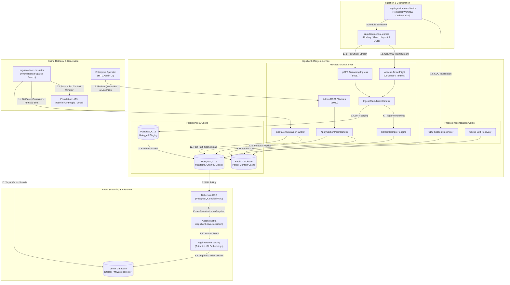
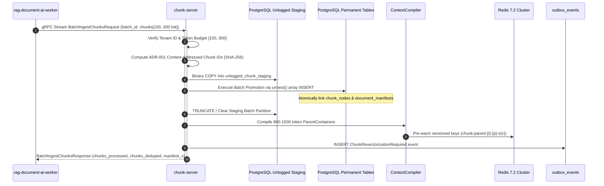
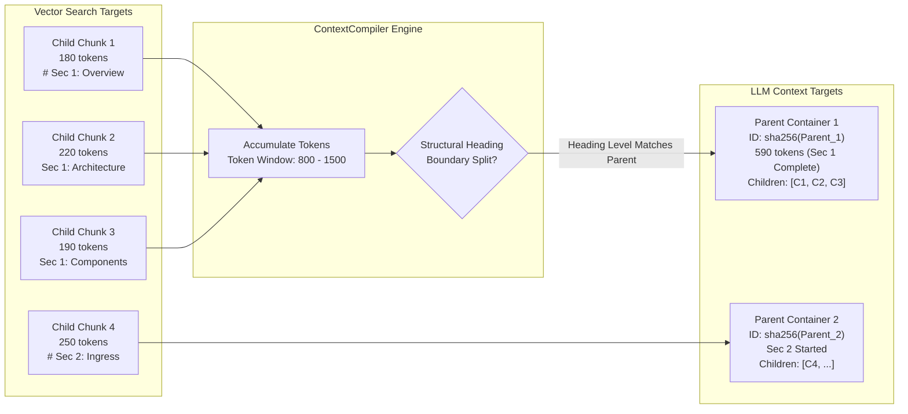
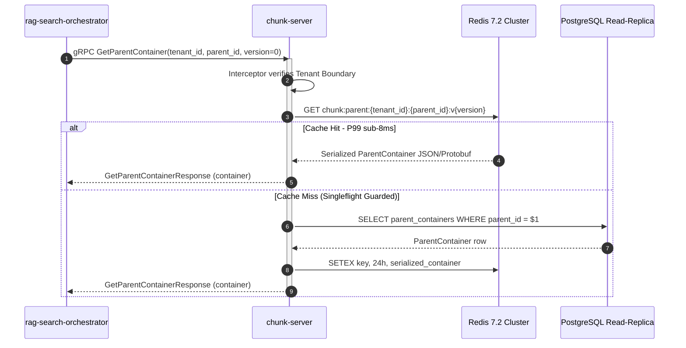

# Architecture Specification: rag-chunk-lifecycle-service & Multimodal RAG Ecosystem

This document provides a comprehensive technical architecture specification for the **`rag-chunk-lifecycle-service`** microservice, its internal hexagonal boundaries, and its interfaces and integration patterns with upstream and downstream microservices across the enterprise Multimodal Retrieval-Augmented Generation (RAG) platform.

---

## Table of Contents

- [1. System Mission &amp; Architectural Vision](#1-system-mission--architectural-vision)
- [2. Multimodal RAG Ecosystem &amp; Microservice Topology](#2-multimodal-rag-ecosystem--microservice-topology)
  - [Ecosystem Topology Diagram](#ecosystem-topology-diagram)
  - [Microservice Reference Catalog](#microservice-reference-catalog)
- [3. Internal Hexagonal Architecture of `rag-chunk-lifecycle-service`](#3-internal-hexagonal-architecture-of-rag-chunk-lifecycle-service)
  - [Boundary Isolation &amp; Dependency Direction](#boundary-isolation--dependency-direction)
  - [Subsystem Breakdown](#subsystem-breakdown)
- [4. Architectural Decision Records (ADRs)](#4-architectural-decision-records-adrs)
- [5. Core Distributed Workflows](#5-core-distributed-workflows)
  - [A. High-Velocity Ingestion &amp; Content-Addressed Staging](#a-high-velocity-ingestion--content-addressed-staging)
  - [B. Hierarchical Parent-Child Context Compilation](#b-hierarchical-parent-child-context-compilation)
  - [C. Section-Key Invalidation &amp; Human-in-the-Loop Quarantine](#c-section-key-invalidation--human-in-the-loop-quarantine)
  - [D. Sub-8ms Context Retrieval Read Plane](#d-sub-8ms-context-retrieval-read-plane)
  - [E. Transactional Outbox Event Publishing](#e-transactional-outbox-event-publishing)
- [6. Data Storage &amp; Schema Topology](#6-data-storage--schema-topology)
  - [PostgreSQL 16 Primary Relational Storage](#postgresql-16-primary-relational-storage)
  - [Redis 7.2 Cluster Context Read Plane](#redis-72-cluster-context-read-plane)
- [7. Operational &amp; Runtime Invariants](#7-operational--runtime-invariants)
- [8. Deployment, Scaling &amp; Resilience Topology](#8-deployment-scaling--resilience-topology)

---

## 1. System Mission & Architectural Vision

In production enterprise RAG systems, document ingestion, chunking, and context compilation face significant challenges:

1. **Volatile Offset Cascades**: Traditional chunk identification based on character or token offsets breaks whenever upstream document layouts or formatting change slightly, leading to massive re-vectorization cascades.
2. **Context Fragmentation**: Retrieval needs small, targeted vector embeddings (100–300 tokens) to minimize dense vector noise, whereas Foundation LLMs require broad, coherent context windows (800–1,500 tokens) containing headings, tables, and surrounding paragraphs.
3. **Upstream Invalidation Conflicts**: When automated Change Data Capture (CDC) streams modify source documents, manual domain-expert section corrections (patches) can be silently overwritten or corrupted.
4. **Read/Write Contention**: Sustained high-throughput batch ingestion ($\ge 25{,}000\text{ chunks/sec}$) can lock relational tables and degrade real-time inference latency.

The **`rag-chunk-lifecycle-service`** solves these challenges by functioning as the **central data consistency and chunk lifecycle authority**:

- **Deterministic Content-Addressing**: Computes stable SHA-256 chunk identifiers.
- **Immutable Document Manifests**: Enforces an append-only lineage ($v_1 \dots v_n$).
- **Parent-Child Compilation**: Binds fine-grained retrieval chunks to coherent parent context containers.
- **Section-Level Quarantine**: Safely isolates CDC merge conflicts without speculative token rebasing.
- **Decoupled Low-Latency Read Plane**: Pre-warms compiled parent containers into Redis 7.2 Cluster for sub-8ms retrieval.

---

## 2. Multimodal RAG Ecosystem & Microservice Topology

### Ecosystem Topology Diagram



---

### Microservice Reference Catalog

| Microservice                                                    | Protocol / Port                             | Role in Platform                                                                                                                            | Interactions with `rag-chunk-lifecycle-service`                                                                                                                                                             |
| :-------------------------------------------------------------- | :------------------------------------------ | :------------------------------------------------------------------------------------------------------------------------------------------ | :------------------------------------------------------------------------------------------------------------------------------------------------------------------------------------------------------------ |
| **`rag-document-ai-worker`**                            | gRPC (`50051`) / Arrow Flight (`50051`) | Document extraction, OCR, layout segmentation (Docling, MinerU), and semantic tokenization.                                                 | **Upstream Client**: Streams child chunks (100–300 tokens) with heading paths, structural section keys, and normalized text into `BatchIngestChunks` or the pure-Go Flight receiver.                 |
| **`rag-ingestion-coordinator`**                         | Temporal gRPC / Internal RPC                | Long-running workflow orchestrator managing bulk ingestion jobs, document re-indexing schedules, and upstream CDC polling.                  | **Orchestrator**: Coordinates ingestion lifecycle, passes tenant credentials, and triggers CDC reconciliation tasks upon upstream document mutations.                                                   |
| **`rag-chunk-lifecycle-service`** *(Current Service)* | gRPC (`50051`), REST (`8080`)           | Central chunk authority, version manifests, deterministic identity, parent compilation, and section patch ledger.                           | **System Core**: Decoupled into `chunk-server` (ingress) and `reconciliation-worker` (CDC reconciliation and cache backfill).                                                                       |
| **`Debezium CDC + Apache Kafka`**                       | PostgreSQL Logical WAL / Kafka (`9092`)   | Asynchronous, guaranteed-delivery event egress fabric.                                                                                      | **Event Consumer**: Debezium tails the `outbox_events` table via PostgreSQL WAL logical decoding and routes `ChunkRevectorizationRequired` events to Kafka topic `rag.chunk.revectorization`.     |
| **`rag-inference-serving`**                             | Kafka Consumer / Triton HTTP/gRPC           | GPU-accelerated model inference cluster (Triton Inference Server, vLLM, TensorRT-LLM) generating dense (e.g. BGE-M3) and sparse embeddings. | **Downstream Consumer**: Subscribes to `rag.chunk.revectorization` from Kafka, vectorizes new/modified child chunks, and writes embeddings to the vector database.                                    |
| **`rag-search-orchestrator`**                           | gRPC / REST                                 | Real-time hybrid search engine, query expander, and prompt context assembler.                                                               | **Downstream Client**: After vector search identifies relevant child chunk IDs, queries `GetParentContainer` to retrieve full 800–1,500 token parent containers ($P99 \le 8\text{ms}$) from Redis. |
| **Operator Admin Portal**                                 | REST / HTTPS (`8080`)                     | Web interface for human-in-the-loop (HITL) domain experts to inspect quarantined sections, diff conflicts, and apply patches.               | **Administrative Client**: Consumes `/v1/conflicts/quarantine` and executes `accept-upstream` or `reapply-override` actions.                                                                      |

---

## 3. Internal Hexagonal Architecture of `rag-chunk-lifecycle-service`

The service strictly adheres to **Clean / Hexagonal Architecture (Ports and Adapters)** to decouple domain invariants from database drivers, serialization frameworks, and transport protocols.

```
                              ┌────────────────────────────────────────────────────────┐
                              │                    Transport Layer                     │
                              │  ┌───────────────────────┐  ┌───────────────────────┐  │
                              │  │ gRPC Handlers &       │  │ HTTP Router &         │  │
                              │  │ Interceptors (:50051) │  │ Quarantine (:8080)    │  │
                              │  └───────────┬───────────┘  └───────────┬───────────┘  │
                              └──────────────┼──────────────────────────┼──────────────┘
                                             │                          │
                                             ▼                          ▼
                              ┌────────────────────────────────────────────────────────┐
                              │                   Application Layer                    │
                              │  ┌──────────────────────────────────────────────────┐  │
                              │  │ Command Handlers:                                │  │
                              │  │ - IngestChunkBatchHandler                        │  │
                              │  │ - ApplySectionPatchHandler                       │  │
                              │  │ - ReconcileCDCUpdateHandler                      │  │
                              │  │ - AcceptUpstreamCDCHandler                       │  │
                              │  │ - ReapplyOverrideHandler                         │  │
                              │  │ Query Handlers:                                  │  │
                              │  │ - GetParentContainerHandler                      │  │
                              │  │ - ListQuarantinedPatchesHandler                  │  │
                              │  └──────────────────────────┬───────────────────────┘  │
                              └─────────────────────────────┼──────────────────────────┘
                                                            │
                                             ┌──────────────┴──────────────┐
                                             ▼                             ▼
               ┌──────────────────────────────────────────┐   ┌──────────────────────────────────────────┐
               │               Domain Core                │   │             Repository Ports             │
               │  ┌────────────────────────────────────┐  │   │  ┌────────────────────────────────────┐  │
               │  │ Entities & Value Objects:          │  │   │  │ - ManifestRepository               │  │
               │  │ - DocumentManifest (v_1 ... v_n)   │  │   │  │ - ChunkRepository                  │  │
               │  │ - ChunkNode (100-300 tok)          │  │   │  │ - ParentRepository                 │  │
               │  │ - ParentContainer (800-1500 tok)   │  │   │  │ - PatchRepository                  │  │
               │  │ - SectionPatch (Quarantine State)  │  │   │  │ - OutboxRepository                 │  │
               │  │ Domain Services:                   │  │   │  │ - ParentCache                      │  │
               │  │ - ContentHasher (ADR-001 SHA-256)  │  │   │  └─────────────────▲──────────────────┘  │
               │  │ - ContextCompiler (Windowing)      │  │                        │                     │
               │  │ - SectionReconciler (ADR-002)      │  │                        │                     │
               │  └────────────────────────────────────┘  │                        │                     │
               └──────────────────────────────────────────┘                        │                     │
                                                                                   │                     │
                              ┌────────────────────────────────────────────────────┴───┐                 │
                              │                 Infrastructure Adapters                │                 │
                              │  ┌──────────────────────────────────────────────────┐  │                 │
                              │  │ - Postgres Connection Pool (pgxpool / PgBouncer) ├──┼─────────────────┘
                              │  │ - Batch Writer (PostgreSQL COPY / unnest staging)│  │
                              │  │ - Postgres Repository Adapters                   │  │
                              │  │ - RedisParentCache (Redis 7.2 UniversalClient)   │  │
                              │  │ - FlightReceiver (Pure-Go Arrow Flight)          │  │
                              │  │ - Prometheus Telemetry Registry                  │  │
                              │  └──────────────────────────────────────────────────┘  │
                              └────────────────────────────────────────────────────────┘
```

### Boundary Isolation & Dependency Direction

1. **Domain Layer (`internal/domain/`)**:
   - Contains pure business logic, entities, value objects, domain compilers, and sentinel errors.
   - **Zero external dependencies**: Contains no SQL imports, no Redis drivers, and no protobuf generated stubs.
2. **Application Layer (`internal/application/`)**:
   - Coordinates use cases via Command Query Responsibility Segregation (CQRS).
   - Ingests child chunks, applies patches, compiles contexts, and dispatches outbox events.
   - Depends exclusively on domain entities and repository port interfaces.
3. **Infrastructure Layer (`internal/infrastructure/`)**:
   - Implements domain repository and cache ports using concrete technologies (`jackc/pgx/v5`, `redis/go-redis/v9`).
   - Manages connection pools, unlogged staging table copies, and Prometheus instrumentation.
4. **Transport Layer (`internal/transport/`)**:
   - Converts network protocols into application commands and queries.
   - Houses gRPC streaming interceptors (panic recovery, tenant validation, secured logging) and net/http REST routers.

---

## 4. Architectural Decision Records (ADRs)

### ADR-001: Deterministic Content-Addressed Chunk Identities

- **Context**: Relying on volatile character/token offsets causes severe misalignment cascades across continuous document revisions.
- **Decision**: All chunk identities are computed deterministically via canonical SHA-256 over 8-byte big-endian length-prefixed UTF-8 fields:
  $$
  \text{ChunkID} = \text{SHA256}(\text{len}_{8\text{BE}}(\text{TenantID}) \parallel \text{TenantID} \parallel \text{len}_{8\text{BE}}(\text{NormalizedContent}) \parallel \text{NormalizedContent} \parallel \text{len}_{8\text{BE}}(\text{StructuralPath}) \parallel \text{StructuralPath})
  $$
- **Normalization Rules**: Text content undergoes Unicode NFC normalization, converts `\r\n` to `\n`, and trims exterior whitespace.
- **Consequences**: Deduplication is instantaneous; identical chunks across document revisions retain identical IDs, eliminating redundant vectorization.

### ADR-002: Pragmatic Section-Key Invalidation & Quarantine

- **Context**: Upstream document modifications often collide with manual human patches. Speculative 3-way AST token rebasing frequently corrupts sentence boundaries and hallucination guardrails.
- **Decision**: Patch overlays are anchored to structural section keys (e.g. `doc_uuid/sec_4/para_2`). If an upstream CDC event modifies the base content hash of a patched section, the section transitions immediately to `SECTION_STALE_QUARANTINE`.
- **Consequences**: Prevents corrupted parent contexts from reaching downstream LLMs. Isolates conflicts into an administrative quarantine queue for human-in-the-loop resolution.

### ADR-003: Process Separation of Ingress Server and Reconciliation Worker

- **Context**: Sustained network streaming ingress ($\ge 25{,}000\text{ chunks/sec}$) requires aggressive memory recycling (`sync.Pool`) and low latency, whereas CDC reconciliation and cache backfilling involve large table scans and outbox polling.
- **Decision**: Decouple the service into two dedicated binaries:
  1. `cmd/chunk-server`: Stateless, zero-cgo network server handling gRPC and REST traffic.
  2. `cmd/reconciliation-worker`: Asynchronous background worker handling CDC reconciliation loops and cache warming CLI tasks.
- **Consequences**: Resource isolation ensures heavy cache backfill operations never saturate ingress CPU or trigger gRPC connection drops.

### ADR-004: Decoupled Low-Latency Read Plane

- **Context**: Ingestion writes generate heavy table locking and write-ahead log contention in PostgreSQL. Downstream LLM inference pipelines require sub-8ms retrieval of parent containers.
- **Decision**: Retrieval queries (`GetParentContainer`) are satisfied exclusively via Redis 7.2 Cluster with `singleflight` stampede protection. PostgreSQL is queried strictly as a fallback.
- **Consequences**: Read queries achieve sub-8ms P99 latencies completely decoupled from ingestion throughput bursts.

---

## 5. Core Distributed Workflows

### A. High-Velocity Ingestion & Content-Addressed Staging



1. `rag-document-ai-worker` streams batches of 100–300 token child chunks over HTTP/2 gRPC.
2. Interceptors validate tenant boundaries and token limits.
3. Chunks are staged into an unlogged PostgreSQL staging table using high-speed binary `COPY`.
4. When the buffer reaches capacity ($\ge 500$ chunks) or timeout ($50\text{ms}$), records are promoted via `unnest()` into `chunk_nodes` and `manifest_chunk_bindings`.
5. The `ContextCompiler` groups child chunks into 800–1,500 token parent containers and pre-warms Redis.
6. A `ChunkRevectorizationRequired` event is committed into `outbox_events`.

---

### B. Hierarchical Parent-Child Context Compilation



- **Windowing Parameters**: Child chunks are strictly bounded between 100 and 300 tokens. Parent containers target 800–1,500 tokens.
- **Section Boundary Invariant**: When a child chunk introduces a top-level heading boundary (e.g. Markdown `#` or `##`), the current parent container is sealed immediately—even if below 800 tokens—to preserve semantic topic coherence.
- **Parent ID Generation**: Parent containers receive deterministic IDs derived via ADR-001 over their compiled content and structural heading path.

---

### C. Section-Key Invalidation & Human-in-the-Loop Quarantine

```mermaid
sequenceDiagram
    autonumber
    participant Coord as Upstream CDC Event
    participant Worker as reconciliation-worker
    participant DB as PostgreSQL (section_patches)
    participant Outbox as outbox_events
    participant Operator as Operator Admin UI
    participant CS as chunk-server (Quarantine API)

    Coord->>Worker: Upstream Section CDC Update (section_key, new_hash, content)
    activate Worker
    Worker->>DB: Query active SectionPatch for section_key
    alt Base Content Hash Matches Upstream
        Worker->>DB: Advance manifest; patch cleanly rebased
    else Base Content Hash Diverges (Collision)
        Worker->>DB: Update state to SECTION_STALE_QUARANTINE
        Note over DB: Store incoming upstream_content & diff timestamp
        Worker->>Outbox: Emit QuarantineAlert event
    end
    deactivate Worker

    Note over Operator: Operator inspects Quarantine Queue
    Operator->>CS: GET /v1/conflicts/quarantine
    CS-->>Operator: 200 OK (Keyset paginated list of stale patches)
    Operator->>CS: GET /v1/conflicts/{id}
    CS-->>Operator: 200 OK (Side-by-side text diff of patch vs upstream)

    alt Operator Accepts Upstream CDC
        Operator->>CS: POST /v1/conflicts/{id}/accept-upstream
        CS->>DB: Discard patch; mark SUPERSEDED; promote upstream version
    else Operator Re-applies Patch Override
        Operator->>CS: POST /v1/conflicts/{id}/reapply-override
        CS->>DB: Update patch base_content_hash to upstream; mark ACTIVE
        CS->>DB: Recompile parent context & advance manifest (v_n+1)
        CS->>Outbox: Emit ChunkRevectorizationRequired event
    end
```

---

### D. Sub-8ms Context Retrieval Read Plane



---

### E. Transactional Outbox Event Publishing

To prevent dual-write inconsistencies between PostgreSQL and Kafka, the service utilizes the **Transactional Outbox Pattern**:

```
┌────────────────────────────────────────────────────────────────────────┐
│ PostgreSQL 16 ACID Transaction                                         │
│ 1. INSERT / UPDATE document_manifests                                  │
│ 2. INSERT chunk_nodes & manifest_chunk_bindings                        │
│ 3. INSERT parent_containers                                            │
│ 4. INSERT INTO outbox_events (event_id, event_type, payload, ...)      │
└───────────────────────────────────┬────────────────────────────────────┘
                                    │ WAL Logical Decoding
                                    ▼
┌────────────────────────────────────────────────────────────────────────┐
│ Debezium CDC Connector                                                 │
│ Tailing pg_logical/wal2json on outbox_events table                     │
└───────────────────────────────────┬────────────────────────────────────┘
                                    │ Guaranteed At-Least-Once Delivery
                                    ▼
┌────────────────────────────────────────────────────────────────────────┐
│ Apache Kafka Topic: rag.chunk.revectorization                          │
│ Consumed by downstream rag-inference-serving (Triton / vLLM)           │
└────────────────────────────────────────────────────────────────────────┘
```

---

## 6. Data Storage & Schema Topology

### PostgreSQL 16 Primary Relational Storage

The schema is partitioned logically by `tenant_id` across all relational entities:

| Table                       | Purpose                                                                      | Storage Characteristics     | Key Indexes                                                                        |
| :-------------------------- | :--------------------------------------------------------------------------- | :-------------------------- | :--------------------------------------------------------------------------------- |
| `document_manifests`      | Tracks immutable monotonic document versions ($v_1 \dots v_n$).            | Permanent, Append-Only      | `PRIMARY KEY (tenant_id, document_id, version)`                                  |
| `chunk_nodes`             | Stores content-addressed child chunk text, token count, and metadata.        | Permanent, Deduplicated     | `PRIMARY KEY (tenant_id, chunk_id)`                                              |
| `manifest_chunk_bindings` | Relational junction binding manifests to their constituent child chunks.     | Permanent, Indexed Junction | `PRIMARY KEY (tenant_id, document_id, manifest_version, chunk_id)`               |
| `parent_containers`       | Stores compiled 800–1,500 token parent context containers and child arrays. | Permanent, Pre-warmed       | `PRIMARY KEY (tenant_id, parent_id, manifest_version)`                           |
| `section_patches`         | Operator override ledger tracking patch states and CDC conflicts.            | High Update/Audit           | `PRIMARY KEY (patch_id)`, Index on `(tenant_id, status, created_at, patch_id)` |
| `outbox_events`           | Outbox event log for WAL tailing to Kafka.                                   | High Throughput Queue       | `PRIMARY KEY (event_id)`, Index on `(created_at, status)`                      |
| `unlogged_chunk_staging`  | Ingestion staging buffer bypassing WAL overhead.                             | Unlogged Staging Buffer     | `INDEX on (staging_batch_id, tenant_id)`                                         |

### Redis 7.2 Cluster Context Read Plane

Parent containers are cached under deterministic, versioned keys:

- **Key Schema**: `chunk:parent:{tenant_id}:{parent_id}:v{version}`
- **TTL Strategy**: 24-hour sliding TTL with active eviction on explicit patch supersede.
- **Fast-Path Latency**: $P95 \le 3\text{ms}$, $P99 \le 8\text{ms}$.
- **Cache Stampede Guard**: Queries leverage `golang.org/x/sync/singleflight` to ensure duplicate concurrent cache misses trigger only a single database query.

---

## 7. Operational & Runtime Invariants

1. **Strict Tenant Boundary Isolation**: Every repository interface, cache key, and gRPC interceptor enforces `tenant_id`. Cross-tenant data leakage is structurally impossible.
2. **Mandatory Doc API Synchronization**: Changes to gRPC interfaces (`api/proto/v1/`) or REST routes (`internal/transport/http/`) must be reflected simultaneously in `api/openapi/openapi.yaml` and Protobuf documentation comments.
3. **Strictly Secured Logging**: Log emissions use structured JSON (`log/slog`). All authorization headers, credentials, and raw text chunk payloads are scrubbed, logging only SHA-256 hashes, chunk IDs, and token counts.
4. **Zero-Cgo Ingress**: The primary gRPC streaming ingress path is built with pure Go (`CGO_ENABLED=0`), eliminating cgo thread transitions and ensuring predictable garbage collection pauses.
5. **Bounded Pod Memory Envelope**: Pod RSS is designed to operate stably below $1.2\text{ GiB}$ under $25{,}000\text{ chunks/sec}$ load, with an outer Kubernetes limit of $1.5\text{ GiB}$.

---

## 8. Deployment, Scaling & Resilience Topology

### Kubernetes Workload Decoupling (ADR-003)

```
                            Kubernetes Cluster (Namespace: rag-system)
 ┌────────────────────────────────────────────────────────────────────────────────────────┐
 │ Ingress Plane: rag-chunk-server (Stateless Deployment / Argo Rollout)                 │
 │ - Replicas: 3 to 10 (HPA target 65% CPU)                                              │
 │ - PodDisruptionBudget: minAvailable 2                                                  │
 │ - Anti-Affinity: topology.kubernetes.io/zone (Multi-AZ spreading)                      │
 │ - Resources: Requests 500m / 512Mi | Limits 2000m / 1.5Gi                              │
 │ - Container: gcr.io/distroless/static:nonroot (UID 65532, Read-only root filesystem)  │
 └────────────────────────────────────────────────────────────────────────────────────────┘

 ┌────────────────────────────────────────────────────────────────────────────────────────┐
 │ Maintenance Plane: rag-reconciliation-worker (Decoupled Worker Deployment)            │
 │ - Replicas: 2 (Static)                                                                 │
 │ - Tasks: Upstream CDC reconciliation loop & on-demand cache backfill CLI               │
 │ - Resources: Requests 250m / 256Mi | Limits 1000m / 768Mi                              │
 └────────────────────────────────────────────────────────────────────────────────────────┘
```

### GitOps Delivery Pipeline (ArgoCD & Argo Rollouts)

- **Continuous Delivery**: Manifests in `deployments/argocd/` employ automated drift reconciliation (`selfHeal: true`, `prune: true`).
- **Canary Progressive Rollout**: Traffic advances from 10% $\to$ 25% $\to$ 100% via Argo Rollouts analysis templates monitoring Prometheus SLIs:
  - **Compilation Duration**: $P99 \le 120\text{ms}$
  - **Quarantine Error Rate**: $\le 2\%$

---

## Summary Reference Table

| Aspect                        | Implementation                                                                        |
| :---------------------------- | :------------------------------------------------------------------------------------ |
| **Service Name**        | `rag-chunk-lifecycle-service`                                                       |
| **Language & Runtime**  | Go 1.23+ (`CGO_ENABLED=0`)                                                          |
| **Ingress Protocols**   | gRPC (HTTP/2) on port `50051`, REST HTTP/1.1 on port `8080`, pure-Go Arrow Flight |
| **Primary Persistence** | PostgreSQL 16+ (via PgBouncer in transaction mode)                                    |
| **Context Cache**       | Redis 7.2 Cluster                                                                     |
| **Event Egress**        | Debezium CDC $\to$ Apache Kafka (`rag.chunk.revectorization`)                     |
| **Container Base**      | `gcr.io/distroless/static:nonroot` (UID 65532)                                      |
| **Orchestration**       | Kubernetes 1.28+, Helm 3, ArgoCD, Argo Rollouts                                       |
